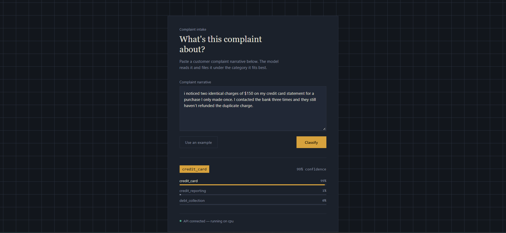
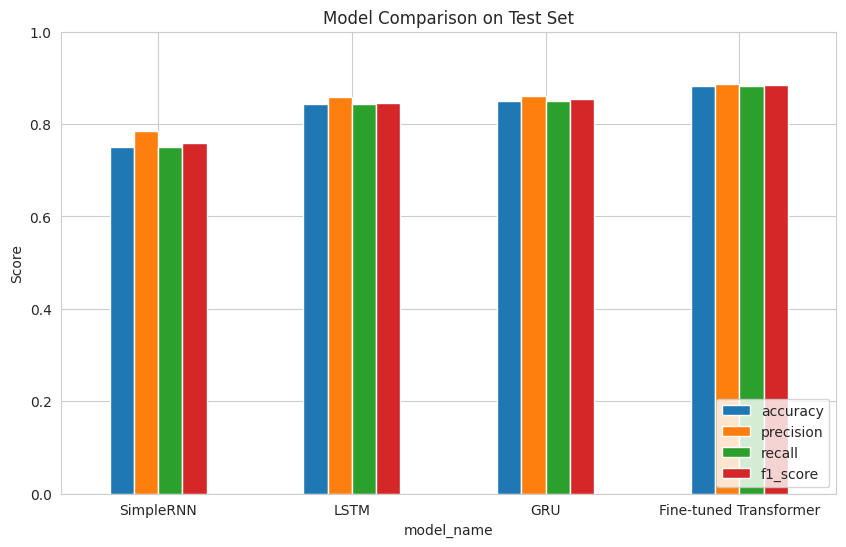
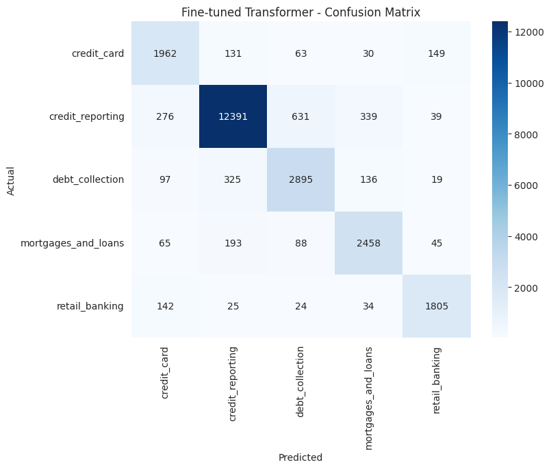

# Consumer Complaint Classification


An end-to-end NLP project that classifies consumer complaint narratives into
one of five categories. Four models — a SimpleRNN, an LSTM, a GRU, and a
fine-tuned transformer — are trained from the same preprocessing pipeline and
compared on the same held-out test set. The best-performing model is served
through a FastAPI backend with a small web frontend on top.

[**Try the model on Hugging Face →**](https://huggingface.co/Ahmed-Tarek0/complaint-classifier)



## Table of contents

- [Overview](#overview)
- [Dataset](#dataset)
- [Approach](#approach)
- [Results](#results)
- [Project structure](#project-structure)
- [Deployment architecture](#deployment-architecture)
- [Getting started](#getting-started)
  - [1. Notebook](#1-notebook)
  - [2. Backend](#2-backend)
  - [3. Frontend](#3-frontend)
- [Tech stack](#tech-stack)
- [Acknowledgments](#acknowledgments)
- [Author](#author)
- [License](#license)

## Overview

Given a free-text complaint narrative, the goal is to predict which category
it belongs to:

| Category | Description |
|---|---|
| `credit_card` | Charges, fraud, and fees on credit cards |
| `credit_reporting` | Issues with credit reports and credit bureaus |
| `debt_collection` | Debt collection practices |
| `mortgages_and_loans` | Mortgage and loan applications |
| `retail_banking` | Checking/savings accounts and retail banking |

The project covers the full pipeline: data cleaning and preprocessing,
training and comparing four text classification architectures, and
deploying the best one behind a REST API with a web UI.

## Dataset

[Consumer Complaint Dataset for NLP](https://www.kaggle.com/datasets/shashwatwork/consume-complaints-dataset-fo-nlp)
on Kaggle — complaint narratives labeled with one of the five categories above.

## Approach

1. **Preprocessing**: lowercasing, punctuation/number removal, stopword
   removal, lemmatization.
2. **Class imbalance**: handled with class-weighted loss across all four
   models.
3. **Models trained from the same train/val/test split**:
   - `SimpleRNN` — baseline recurrent model
   - `LSTM` — gated recurrent model
   - `GRU` — gated recurrent model
   - **Fine-tuned transformer** (`distilbert-base-uncased`) — fine-tuned with
     the Hugging Face `Trainer`, using the raw (non-lemmatized) narrative
     text, since pretrained transformers rely on natural language structure
     that stopword/punctuation removal would discard.
4. **Evaluation**: accuracy, precision, recall, F1-score, and confusion
   matrices on the same test set for all four models.

## Results



| Model | Accuracy | Precision | Recall | F1-score |
|---|---|---|---|---|
| SimpleRNN | 0.749 | 0.784 | 0.749 | 0.759 |
| LSTM | 0.842 | 0.858 | 0.842 | 0.846 |
| GRU | 0.850 | 0.861 | 0.850 | 0.853 |
| **Fine-tuned Transformer** | **0.883** | **0.887** | **0.883** | **0.884** |

The fine-tuned transformer outperforms all three from-scratch recurrent
models, benefiting from pretrained language understanding that the others
don't have access to. It was selected as the model served in deployment.

**Fine-tuned transformer — confusion matrix:**



## Project structure

```
Consumer-Complaint-Classification/
├── notebook.ipynb              # data prep, training, and model comparison
├── assets/                     # images used in this README
└── deployment/
    ├── backend/                # FastAPI service
    │   ├── app/
    │   │   ├── main.py         # app wiring: FastAPI instance, CORS, startup
    │   │   ├── config.py       # all settings, read from env / .env
    │   │   ├── schemas.py      # request/response contracts (Pydantic)
    │   │   ├── model_loader.py # loads the model once, from Hugging Face Hub
    │   │   ├── inference.py    # text -> prediction (no HTTP code)
    │   │   └── routers/
    │   │       ├── predict.py  # POST /predict
    │   │       └── health.py   # GET /health
    │   ├── requirements.txt
    │   ├── .env.example
    │   └── run.py
    └── frontend/                # static HTML/CSS/JS client
        ├── index.html
        ├── style.css
        └── script.js
```

## Deployment architecture

```
┌──────────────┐        POST /predict         ┌──────────────────┐
│   Frontend   │ ────────────────────────────▶ │  FastAPI backend │
│ (HTML/CSS/JS)│ ◀──────────────────────────── │                  │
└──────────────┘      { category, scores }     └─────────┬────────┘
                                                            │
                                                            │ loads once at startup
                                                            ▼
                                                 ┌────────────────────┐
                                                 │  Hugging Face Hub  │
                                                 │ fine-tuned DistilBERT │
                                                 └────────────────────┘
```

The backend and frontend are fully decoupled — the frontend only talks to
the backend over HTTP, and the backend has no knowledge of how its response
is displayed. The model itself isn't shipped with the repo: it's hosted on
the Hugging Face Hub and downloaded automatically the first time the backend
starts, so no manual export step is needed to run this project.

## Getting started

### 1. Notebook

Open `notebook.ipynb` in Kaggle, Colab, or Jupyter. It downloads the dataset,
trains all four models, and produces the comparison above. GPU is
recommended — fine-tuning the transformer on CPU is impractical.

### 2. Backend

```bash
cd deployment/backend
pip install -r requirements.txt
cp .env.example .env
python run.py
```

The API comes up at `http://127.0.0.1:8000`. Interactive docs are at
`http://127.0.0.1:8000/docs`. On first run, it downloads the model from
[Hugging Face](https://huggingface.co/Ahmed-Tarek0/complaint-classifier) —
this only happens once.

Health check:

```bash
curl http://127.0.0.1:8000/health
```

### 3. Frontend

```bash
cd deployment/frontend
python -m http.server 5500
```

Open `http://127.0.0.1:5500` in a browser. Make sure the backend is running
first — the page shows a connection status at the bottom.

## Tech stack

- **Modeling**: TensorFlow/Keras (SimpleRNN, LSTM, GRU), Hugging Face
  `transformers` + `datasets` (fine-tuned DistilBERT)
- **Backend**: FastAPI, Pydantic, PyTorch
- **Frontend**: vanilla HTML/CSS/JS
- **Model hosting**: Hugging Face Hub

## Acknowledgments

- Dataset: [Consumer Complaint Dataset for NLP](https://www.kaggle.com/datasets/shashwatwork/consume-complaints-dataset-fo-nlp) on Kaggle
- Base model: [`distilbert-base-uncased`](https://huggingface.co/distilbert-base-uncased) by Hugging Face

## Author

**Ahmed Tarek**
[GitHub](https://github.com/Ahmed-Tarek0)
